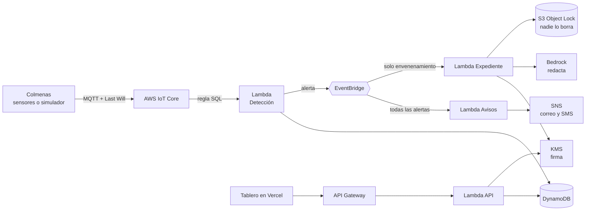

# KAB Centinela 🐝

**La colmena que escucha:** detecta en minutos el envenenamiento de abejas por plaguicidas, avisa al apicultor y guarda una prueba que nadie puede borrar.

- **Tablero en vivo (ábrelo en el celular):** https://kab-centinela.vercel.app
- **Construido sobre AWS:** 9 servicios desplegados con infraestructura como código (AWS SAM).

> *Kab* significa "abeja" y "miel" en maya.

---

## Índice

1. [El problema](#1-el-problema)
2. [La solución](#2-la-solución)
3. [Servicios de AWS que usamos](#3-servicios-de-aws-que-usamos)
4. [Código, librerías y uso de IA](#4-código-librerías-y-uso-de-ia)
5. [Cómo se ejecuta](#5-cómo-se-ejecuta)
6. [Cómo probar la demo en 5 minutos](#6-cómo-probar-la-demo-en-5-minutos)
7. [Equipo](#7-equipo)

---

## 1. El problema

En la Península de Yucatán las abejas se están muriendo y casi nunca hay pruebas de por qué.

**El caso que lo resume: Nohalal, Tekax (2025).** Una fumigación envenenó 99 colmenas de 5 apiarios. ECOSUR encontró fipronil 39% por encima de la dosis letal media, y la prensa reportó más de 3 millones de abejas muertas. Un año después **nadie ha sido sancionado**, porque cuando el apicultor llega al apiario ya no hay cómo demostrar qué pasó, ni cuándo. ([Por Esto!, 2026](https://www.poresto.com/yucatan/2026/7/19/apicultura-maya-lucha-por-sobrevivir-en-yucatan-ocho-millones-de-abejas-muertas-en-3-anos-2.html))

**No es un caso aislado:**

| Qué pasa | Dato | Fuente |
| --- | --- | --- |
| Envenenamientos masivos sin castigo | Más de 8 millones de abejas muertas por plaguicidas en Campeche y Yucatán entre 2023 y 2025. El fipronil está prohibido en la Unión Europea y en México sigue autorizado. | [Por Esto!, 2025](https://www.poresto.com/yucatan/2025/7/6/plaguicidas-matan-mas-de-8-millones-de-abejas-en-la-peninsula-de-yucatan-dos-ecocidios-masivos-siguen-impunes-y-sin-responsable.html) |
| Mucha gente depende de la miel | Yucatán es el primer productor de México: 9,893 toneladas en 2025 (16.4% del país). En la Península hay unos 17 mil apicultores, la mayoría familias mayas, y cerca de 48 mil empleos. | [SADER vía Por Esto!, 2026](https://www.poresto.com/yucatan/2026/8/31/yucatan-lidera-produccion-de-miel-en-mexico-con-casi-10-mil-toneladas.html), [Por Esto!, 2026](https://www.poresto.com/yucatan/2026/4/20/la-miel-que-se-acaba-deforestacion-y-pesticidas-amenazan-la-apicultura-maya-en-yucatan.html) |
| El apicultor cobra poco | El intermediario paga entre 35 y 50 pesos por kilo; el consumidor paga 150 o más. | [Por Esto!, 2026](https://www.poresto.com/yucatan/2026/7/19/apicultura-maya-lucha-por-sobrevivir-en-yucatan-ocho-millones-de-abejas-muertas-en-3-anos-2.html) |
| El clima ya pega fuerte | Con hasta 44 °C a la sombra en 2023, la producción cayó entre 20 y 30%. En 2026 los frentes fríos secaron la floración. | [N+, 2023](https://www.nmas.com.mx/estados/yucatan-calor-provoca-muerte-de-abejas-produccion-de-miel-en-riesgo/), [Diario de Yucatán, 2026](https://www.yucatan.com.mx/merida/2026/05/06/crisis-apicola-en-yucatan-frio-deforestacion-y-bajos-precios-golpea-la-produccion-de-miel.html) |
| Cada vez hay menos flores | Se perdieron 285,580 hectáreas de selva entre 2019 y 2023 por agroindustria, ganadería, megagranjas y obras. | [Por Esto!, 2026](https://www.poresto.com/yucatan/2026/4/20/la-miel-que-se-acaba-deforestacion-y-pesticidas-amenazan-la-apicultura-maya-en-yucatan.html) |
| Sin abejas no hay cosechas | Cerca del 85% de los cultivos comestibles de México dependen de polinizadores; ese servicio vale unos 80 mil millones de pesos al año. | [Vandame et al., ECOSUR, 2019](https://repositorio-socioecologia.conahcyt.mx/jspui/bitstream/1000/252/1/2.%20Abejas%20apicultores%20y%20acade%cc%81micos%20en%20alianza%20por%20la%20sostenibilidad%20de%20territorios%20con%20diversidad%20biocultural%20en%20Me%cc%81xico.pdf) |

**En resumen:** muere la abeja, pierde el apicultor, pierde el campo que necesita polinización, y el responsable no paga porque no hay evidencia.

---

## 2. La solución

KAB Centinela pone en cada colmena un sensor que **la pesa, mide su calor y escucha su zumbido**. Con eso hace cuatro cosas:

| | Qué hace | Cómo lo ve el apicultor |
| --- | --- | --- |
| 🔎 **Detecta** | Reconoce 10 problemas en la colmena (tabla de abajo). | La colmena se pone en rojo, naranja o amarillo en el tablero. |
| 📲 **Avisa** | Manda el aviso en segundos. | Llega un correo o SMS, y en el celular ve **qué hacer, paso a paso**. |
| 🛡️ **Prueba** | Si hay envenenamiento, arma un expediente con los datos del sensor, lo firma digitalmente y lo guarda donde nadie lo puede borrar ni cambiar. | Tiene una **prueba lista para denunciar** ante PROFEPA, que puede imprimir o mandar por WhatsApp. |
| 🍯 **Certifica** | Emite un certificado firmado del lote de miel: de dónde viene y si el apiario estuvo libre de envenenamientos. | El comprador escanea un **QR** y comprueba el origen, así el apicultor puede pedir mejor precio. |

### Qué detecta y cómo

Cada regla compara la lectura actual con la historia reciente de **esa misma** colmena.

| Problema | Cómo lo reconoce el sistema |
| --- | --- |
| ☠️ Envenenamiento | El zumbido baja 10 dB o más **y** la colmena pierde 0.5 kg o más al mismo tiempo. Una noche fresca baja el zumbido pero no el peso, por eso no se confunde. |
| 🚁 Fumigación en la zona | Envenenamiento en **dos apiarios distintos a menos de 3 km** en menos de 6 horas: es el patrón de una avioneta o un dron. |
| 🌡️ Golpe de calor | La cámara de cría pasa de 38 °C (crítico desde 40 °C). |
| 💧 Sequía | Humedad menor a 30% con más de 35 °C durante horas. |
| ❄️ Frío extremo | La cría baja de 30 °C con viento frío afuera. |
| 🌼 Hambruna (sin flores) | La colmena pierde 0.25 kg o más cada día durante al menos 2 días. |
| 👑 Sin reina | El zumbido se vuelve agudo (350 Hz o más) y se sostiene. |
| 🐝 Enjambrazón | Pierde de 1.5 a 5 kg de golpe: media colonia se fue. |
| 🦠 Varroa o enfermedad | No controla su temperatura y su zumbido baja poco a poco durante un día. |
| 📡 Sensor caído o robo | El sensor deja de transmitir sin despedirse (Last Will de IoT Core). |

### Pensado para el campo

El tablero es para apicultores que no usan mucho el celular:
- **Letra grande**, con un botón para agrandarla más.
- **Palabras en vez de números técnicos**: "el zumbido está muy bajo, casi no zumban" en lugar de "56 dB".
- **Cada estado lleva ícono, color y palabra**, nunca solo color: palomita verde = Bien, triángulo = Revisar, señal de alto roja = ¡Urgente!
- **Botón 🔊 Escuchar:** el teléfono lee el aviso en voz alta.
- **Botón 💬 WhatsApp:** manda el aviso a vecinos o a la cooperativa.
- **Mapa de apiarios**, con el círculo de 3 km alrededor de un envenenamiento.
- **Botones grandes y la navegación abajo**, al alcance del pulgar.

---

## 3. Servicios de AWS que usamos

Todo es *serverless* (sin servidores que mantener) y se despliega con un solo comando desde [`backend/template.yaml`](backend/template.yaml).

### Cómo viaja un dato



1. El sensor de la colmena publica una lectura por **MQTT** a **AWS IoT Core**.
2. Una **regla de IoT** manda la lectura a la **Lambda de detección**, que corre las reglas y guarda todo en **DynamoDB**.
3. Si hay un problema, la Lambda publica una alerta en **EventBridge**.
4. EventBridge reparte la alerta. La **Lambda de avisos** la manda por **SNS** (correo y SMS). Si es envenenamiento, la **Lambda de expediente**:
   - firma los datos con **KMS**;
   - pide a **Bedrock** que redacte el texto para la denuncia;
   - guarda todo en **S3 con Object Lock**.
5. El tablero web lee todo por **API Gateway**.

### Para qué sirve cada servicio

| Servicio | Para qué lo usamos | En el código |
| --- | --- | --- |
| **AWS IoT Core** | Recibe las lecturas de cada colmena por MQTT con certificado. Si un sensor se apaga de golpe, publica su *Last Will* y así nos enteramos. Dos reglas SQL invocan las Lambdas. | `PoliticaIoT`, eventos `IoTRule` |
| **AWS Lambda** | Cinco funciones en Python 3.12: detección, conexión, avisos, expediente y API. | [`backend/src/handlers/`](backend/src/handlers/) |
| **Amazon DynamoDB** | Cuatro tablas: lecturas (se borran solas a los 30 días), estado de cada colmena, alertas y documentos firmados. | `TablaLecturas`, `TablaColmenas`, `TablaEventos`, `TablaDocumentos` |
| **Amazon EventBridge** | Bus de eventos propio. Cada alerta se publica una vez y cada Lambda recibe solo lo que le toca. | `BusEventos` |
| **Amazon SNS** | Manda el aviso por correo (todas las alertas) y por SMS (solo las urgentes, para cuidar el costo). | `TopicAlertas` |
| **AWS KMS** | Llave ECDSA P-256 que firma expedientes y certificados. La llave privada nunca sale de AWS. | `LlaveFirma` |
| **Amazon S3 Object Lock** | Guarda cada expediente en modo COMPLIANCE: nadie, ni el administrador, lo puede borrar o cambiar mientras dura la retención. | `BucketEvidencia` |
| **Amazon Bedrock** | Redacta el expediente en español formal a partir de los datos firmados. Usa Amazon Nova Lite; se puede cambiar a Claude con un parámetro. | [`narrativa.py`](backend/src/kab_core/narrativa.py) |
| **Amazon API Gateway** | API HTTP pública para el tablero, el certificado con QR y la verificación de firmas. | `HttpApi` |

> **¿Por qué la prueba no se puede falsificar?** El expediente se convierte en un texto único y se calcula su huella digital (SHA-256), y KMS la firma. Si alguien cambia **un solo dato**, la huella cambia y la firma deja de valer. En el tablero hay un botón "Alterar un dato" para comprobarlo. Bedrock solo escribe el texto explicativo: la evidencia son los datos firmados, no ese texto.

---

## 4. Código, librerías y uso de IA

### Código propio

| Carpeta | Qué hay |
| --- | --- |
| [`backend/`](backend/) | Infraestructura (AWS SAM) y las 5 Lambdas en Python. La lógica está separada en [`kab_core/`](backend/src/kab_core/) para probarla sin AWS: reglas de detección, firma, narrativa y certificado. |
| [`backend/tests/`](backend/tests/) | 24 pruebas automáticas (pytest). |
| [`simulador/`](simulador/) | Simula 7 colmenas de Tekax y Peto, o 14 colmenas de toda la región con un caso distinto cada una. Publica a IoT Core o corre todo en local, sin internet. |
| [`web/`](web/) | Tablero en Next.js, desplegado en Vercel. Funciona también sin AWS, con datos de muestra. |
| [`scripts/`](scripts/) | Revisar la cuenta de AWS, verificar teléfonos para SMS y limpiar los datos entre ensayos. |
| [`docs/`](docs/) | [Contrato de datos](docs/contrato-datos.md): el formato que debe mandar un sensor, más un ejemplo. |

### Librerías de terceros

| Librería | Versión | Para qué | Licencia |
| --- | --- | --- | --- |
| [boto3](https://github.com/boto/boto3) | 1.43 | Hablar con AWS desde Python | Apache-2.0 |
| [paho-mqtt](https://github.com/eclipse/paho.mqtt.python) | 2.1 | Conectar el simulador a IoT Core por MQTT | EPL-2.0 / EDL-1.0 |
| [anthropic](https://github.com/anthropics/anthropic-sdk-python) | 2.3 | Cliente de Bedrock para modelos Claude (opcional) | MIT |
| [pytest](https://pytest.org) | 9.1 | Pruebas automáticas | MIT |
| [Next.js](https://nextjs.org) | 16.3.8 | Tablero web | MIT |
| [React](https://react.dev) | 19.3.0 | Interfaz | MIT |
| [Leaflet](https://leafletjs.com) | 1.9.4 | Mapa de apiarios | BSD-2-Clause |
| [qrcode.react](https://github.com/zpao/qrcode.react) | 4.2.0 | Código QR del certificado | ISC |
| [OpenStreetMap](https://www.openstreetmap.org/copyright) | — | Imágenes del mapa | ODbL |
| [Atkinson Hyperlegible](https://fonts.google.com/specimen/Atkinson+Hyperlegible) | — | Tipografía fácil de leer | OFL |

Herramientas: AWS SAM CLI, AWS CLI, cfn-lint y Vercel.

### Uso de inteligencia artificial

- **En el desarrollo:** partes del código, la investigación del problema y este documento se hicieron con ayuda de un asistente de IA (Claude, de Anthropic). El equipo revisó, probó, desplegó y puede explicar cada parte.
- **Dentro del producto:** Amazon Bedrock (Amazon Nova Lite) redacta el texto del expediente. Si Bedrock falla, se usa una plantilla fija para que la demo nunca se caiga.
- **Datos:** los sensores de la demo son simulados. Las cifras del problema vienen de las fuentes citadas en la sección 1.

---

## 5. Cómo se ejecuta

Hay dos formas: **en tu computadora sin AWS** (para ver que funciona) o **completo en AWS**.

### Lo que necesitas

| Para | Necesitas |
| --- | --- |
| Probar en local | Python 3.12 y Node.js 20 o superior |
| Desplegar en AWS | Lo anterior, más una cuenta de AWS, [AWS CLI](https://aws.amazon.com/cli/) y [AWS SAM CLI](https://docs.aws.amazon.com/serverless-application-model/latest/developerguide/install-sam-cli.html) |

```bash
git clone https://github.com/miguelangel-espinosadelosmonteros-osuna/kab-centinela.git
cd kab-centinela
python3.12 -m venv .venv && source .venv/bin/activate
pip install pytest "boto3[crt]" paho-mqtt "anthropic[bedrock]"
```

### Opción A: en tu computadora, sin AWS (2 minutos)

```bash
# 1. Las pruebas automáticas
cd backend && pytest && cd ..

# 2. Las reglas de detección con todos los casos (no necesita internet)
cd simulador && python simular_colmenas.py --modo local --escenario todo --velocidad 0 && cd ..

# 3. El tablero con datos de muestra: abre http://localhost:3000
cd web && npm install && npm run dev
```

### Opción B: completo en AWS

**Paso 1. Conecta tu cuenta de AWS.** Nunca pongas llaves en el repositorio.
```bash
aws login --region us-east-1         # o: aws configure
./scripts/revisar_aws.sh             # revisa que tengas los 9 servicios
```

**Paso 2. Despliega la infraestructura** (unos 4 minutos):
```bash
cd backend
sam build
sam deploy --stack-name kab-centinela --region us-east-1 --resolve-s3 --capabilities CAPABILITY_IAM \
  --parameter-overrides RetencionEvidenciaDias=1 CorreoAlertas=tu@correo.com
```
Al terminar, la terminal muestra la **`ApiUrl`** (para el tablero) y la **`PoliticaIoT`** (para el simulador). Revisa tu correo y **confirma la suscripción de SNS**.

| Parámetro | Qué es | Valor por defecto |
| --- | --- | --- |
| `CorreoAlertas` | Correo que recibe los avisos | (vacío) |
| `TelefonoAlertas` | Teléfono para SMS urgentes, formato +52... | (vacío) |
| `RetencionEvidenciaDias` | Días que nadie puede borrar un expediente | 1 |
| `BedrockModelId` | Modelo que redacta el expediente | `amazon.nova-lite-v1:0` |
| `UrlTablero` | URL del tablero, para los links de los avisos y del QR | (vacío) |
| `SmsActivo` | `no` para ensayar sin gastar SMS | `si` |

**Paso 3. Registra el simulador como dispositivo de IoT Core.** Crea su certificado en `simulador/certs/`, carpeta que nunca se sube a GitHub.
```bash
cd ../simulador
python registrar_dispositivo.py --politica <PoliticaIoT>
```

**Paso 4. Manda datos.**
```bash
python simular_colmenas.py --modo iot --escenario normal --velocidad 0.5       # 7 colmenas sanas
python simular_colmenas.py --modo iot --escenario fumigacion --velocidad 0.5   # la fumigación en vivo
python simular_colmenas.py --modo iot --escenario mixto --velocidad 0          # 14 colmenas con 10 casos distintos
python simular_colmenas.py --modo iot --archivo mis_datos.jsonl                # tus propios datos
```
Escenarios disponibles: `normal`, `fumigacion`, `frio`, `calor`, `sequia`, `hambruna`, `sin_reina`, `enjambrazon`, `varroa`, `todo` y `mixto`. Para limpiar los datos entre ensayos: `python ../scripts/reiniciar_demo.py`.

**Paso 5. Publica el tablero.**
```bash
cd ../web
NEXT_PUBLIC_API_URL=<ApiUrl> npm run dev            # en tu computadora
```
En **Vercel**:
1. Importa el repositorio.
2. Pon **Root Directory = `web`**.
3. Agrega la variable `NEXT_PUBLIC_API_URL` con tu `ApiUrl`. La variable `NEXT_PUBLIC_TELEFONO_AYUDA` es opcional y muestra el botón "Llamar al técnico".

**Paso 6 (opcional). SMS.** AWS empieza en modo de prueba: solo manda SMS a números verificados, cada uno cuesta unos 0.10 USD a México, y el límite inicial es de 1 USD al mes.
```bash
./scripts/sms_verificar.sh +52XXXXXXXXXX            # te llega un código
./scripts/sms_verificar.sh +52XXXXXXXXXX 123456     # lo confirmas y quedas suscrito
```

### Apagar todo al terminar

```bash
cd backend && sam delete --stack-name kab-centinela
cd ../simulador && python registrar_dispositivo.py --borrar
```
El bucket de expedientes no se borra a propósito, porque Object Lock lo protege. Vacíalo y bórralo cuando venza la retención (1 día).

### Seguridad

- No hay llaves ni certificados en el repositorio: `.gitignore` excluye `certs/`, `*.pem`, `*.key`, `.env*` y `samconfig.toml`.
- Cada Lambda tiene solo los permisos que necesita.
- La llave privada de firma vive dentro de AWS KMS y no se puede exportar.

---

## 6. Cómo probar la demo en 5 minutos

1. Abre **https://kab-centinela.vercel.app** en el celular. La pantalla de inicio dice cuántas colmenas necesitan ayuda y cuál atender primero.
2. Toca una colmena en rojo (por ejemplo **TEK-04**). Verás qué pasó, **qué hacer paso a paso**, el botón 🔊 para escucharlo y las gráficas de peso, zumbido y calor.
3. Ve a **Pruebas** y abre un expediente:
   - toca **"Comprobar que es auténtica"**: la firma es válida;
   - en "Para técnicos y jueces", toca **"Alterar un dato"** y comprueba otra vez: la firma **falla**.
4. Ve a **Mi miel** y crea un certificado:
   - el apiario de **Peto** sale **apto**;
   - uno de **Nohalal** sale **no apto**;
   - escanea el QR con otro teléfono para verlo como comprador.
5. En la consola de AWS puedes ver las lecturas en DynamoDB, los expedientes bloqueados en S3 y los mensajes en SNS.

---

## 7. Equipo

| Rol | Persona | Qué construyó |
| --- | --- | --- |
| 1. Líder AWS y despliegue | | [`backend/template.yaml`](backend/template.yaml) |
| 2. IoT y simulador | | [`simulador/`](simulador/), [`estado_conexion.py`](backend/src/handlers/estado_conexion.py) |
| 3. Detección y avisos | | [`deteccion.py`](backend/src/kab_core/deteccion.py), [`procesar_telemetria.py`](backend/src/handlers/procesar_telemetria.py), [`notificar.py`](backend/src/handlers/notificar.py) |
| 4. Evidencia e IA | | [`evidencia.py`](backend/src/kab_core/evidencia.py), [`narrativa.py`](backend/src/kab_core/narrativa.py), [`pasaporte.py`](backend/src/kab_core/pasaporte.py), [`expediente.py`](backend/src/handlers/expediente.py) |
| 5. Tablero web | | [`web/`](web/) |
| 6. Problema, pitch y documentación | | `README.md`, [`docs/`](docs/) |

**Siguientes pasos:**
- Entrenar el clasificador de audio con grabaciones reales.
- Usar AWS IoT Core for LoRaWAN en zonas sin señal: un gateway por comunidad cubre varios kilómetros.
- Agregar textos en maya.
- Hacer un piloto con una cooperativa de Tekax.
