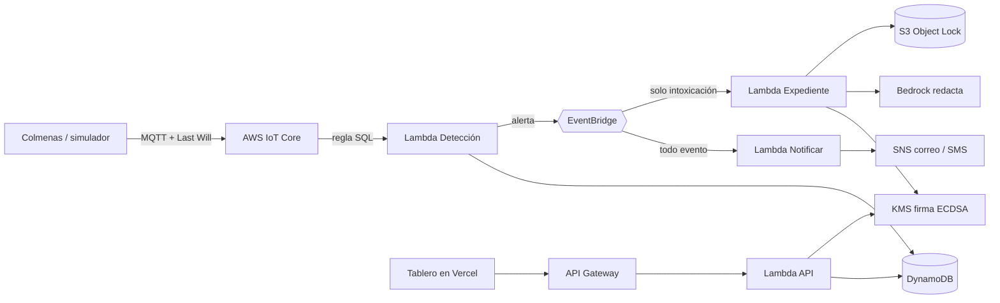

# KAB Centinela 🐝

La colmena que escucha: detecta en minutos el envenenamiento por plaguicidas y lo convierte en evidencia que nadie puede borrar.

## Problema

En Nohalal (Tekax, Yucatán), ECOSUR confirmó en 2025 fipronil un 39% por encima de la dosis letal media: hubo 99 colmenas envenenadas en 5 apiarios, y la prensa reportó más de 3 millones de abejas muertas ([Por Esto!](https://www.poresto.com/yucatan/2026/7/19/apicultura-maya-lucha-por-sobrevivir-en-yucatan-ocho-millones-de-abejas-muertas-en-3-anos-2.html)). Entre 2023 y 2025 murieron más de 8 millones de abejas por plaguicidas en Campeche y Yucatán, y nadie ha sido sancionado ([Por Esto!](https://www.poresto.com/yucatan/2025/7/6/plaguicidas-matan-mas-de-8-millones-de-abejas-en-la-peninsula-de-yucatan-dos-ecocidios-masivos-siguen-impunes-y-sin-responsable.html)). Cuando el apicultor llega al apiario, ya no hay pruebas.

Yucatán es el primer productor de miel de México: 9,893 t en 2025, según SADER ([Por Esto!](https://www.poresto.com/yucatan/2026/8/31/yucatan-lidera-produccion-de-miel-en-mexico-con-casi-10-mil-toneladas.html)). Aun así, el intermediario paga entre 35 y 50 pesos por kilo de miel que se vende en 150. A los plaguicidas se suman el calor extremo, la sequía, la deforestación, que deja a las abejas sin flores, y la varroa. Más datos y fuentes en la página [El problema](web/app/problema/page.js) del tablero.

## Solución

1. **Detecta.** Cada colmena manda peso, temperatura, humedad y sonido a AWS IoT Core. Una Lambda detecta 10 problemas: intoxicación, brote regional por fumigación, golpe de calor, sequía, frío extremo, hambruna, ausencia de reina, enjambrazón, varroa y sensor caído.
2. **Avisa.** El apicultor recibe la alerta por correo y SMS (Amazon SNS) en segundos.
3. **Prueba.** Cada intoxicación genera un expediente firmado con AWS KMS, redactado por Amazon Bedrock y guardado en S3 con Object Lock.
4. **Certifica.** El pasaporte del lote de miel (apto o no apto, con su origen) se firma y el comprador lo verifica con un QR.

## Arquitectura



## Servicios de AWS y para qué los usamos

| Servicio | Uso |
| --- | --- |
| AWS IoT Core | Recibe la telemetría por MQTT. Si un sensor se apaga de golpe, publica su Last Will. Dos reglas SQL invocan las Lambdas. |
| AWS Lambda | Cinco funciones: telemetría (detección), conexión, avisos, expediente y API. |
| Amazon DynamoDB | Lecturas (caducan a los 30 días), estado de cada colmena, eventos y documentos firmados. |
| Amazon EventBridge | Bus propio: cada alerta se publica una vez y cada consumidor se suscribe a lo que le toca. |
| Amazon SNS | Correo con todo y SMS solo para lo crítico, con un filtro por atributo para cuidar el costo. |
| AWS KMS | Llave asimétrica P-256 que firma expedientes y pasaportes; la llave privada nunca sale de KMS. |
| Amazon S3 Object Lock | Guarda el expediente en modo COMPLIANCE: nadie lo puede borrar ni modificar durante la retención. |
| Amazon Bedrock | Redacta el expediente en español formal a partir del JSON firmado. Si falla, se usa una plantilla. |
| Amazon API Gateway | API HTTP para el tablero, el pasaporte con QR y la verificación de firmas. |

## Estructura

```
backend/            AWS SAM: template.yaml + Lambdas en Python (Roles 1, 3 y 4)
  src/kab_core/     lógica sin AWS: contrato, deteccion, evidencia, narrativa, pasaporte
  src/handlers/     una Lambda por archivo
  tests/            pytest
simulador/          7 colmenas en Tekax y Peto, 9 escenarios, modo local e IoT (Rol 2)
web/                tablero Next.js para Vercel (Rol 5)
scripts/            revisar la cuenta de AWS y verificar teléfonos para SMS
docs/               contrato de datos y datos de ejemplo
```

## Cómo se ejecuta

### Requisitos

AWS CLI con credenciales (nunca en el repo), AWS SAM CLI, Python 3.12 y Node 20 o superior.

```bash
python3.12 -m venv .venv && source .venv/bin/activate
pip install pytest boto3 paho-mqtt "anthropic[bedrock]"
./scripts/revisar_aws.sh          # ¿la cuenta tiene los 9 servicios?
```

### Despliegue (Rol 1)

```bash
cd backend
sam build
sam deploy --guided --stack-name kab-centinela --capabilities CAPABILITY_IAM \
  --parameter-overrides RetencionEvidenciaDias=1 CorreoAlertas=equipo@correo.com TelefonoAlertas=+52999XXXXXXX
```

Al terminar, confirma el correo de suscripción de SNS. Copia la salida `ApiUrl`: va en Vercel como `NEXT_PUBLIC_API_URL`.

### SMS

La cuenta empieza en el sandbox de SMS: solo envía a números verificados, con un límite de 1 USD al mes, y cada SMS a México cuesta unos 0.10 USD. Para verificar un número:

```bash
./scripts/sms_verificar.sh +52999XXXXXXX          # llega un código
./scripts/sms_verificar.sh +52999XXXXXXX 123456   # se confirma y se suscribe
```

Para ensayar sin gastar SMS, pon `SmsActivo=no` en el despliegue o `SMS_ACTIVO=no` en la Lambda Notificar.

### Simulación (Rol 2)

```bash
cd simulador
python registrar_dispositivo.py --politica <salida PoliticaIoT>
python simular_colmenas.py --modo iot --escenario fumigacion --velocidad 0.5
python simular_colmenas.py --modo iot --escenario normal --cortar TEK-03   # prueba el Last Will
python simular_colmenas.py --modo local --escenario todo                    # plan B sin internet
```

Para mandar datos propios, revisa el [contrato de datos](docs/contrato-datos.md).

### Tablero (Rol 5)

```bash
cd web && npm install
NEXT_PUBLIC_API_URL=<ApiUrl> npm run dev      # sin la variable usa datos de demostración
```

En Vercel: importa el repo, pon **Root Directory = `web`** y agrega la variable `NEXT_PUBLIC_API_URL`.

### Pruebas

```bash
cd backend && pytest
```

### Apagar recursos

```bash
cd backend && sam delete --stack-name kab-centinela
cd ../simulador && python registrar_dispositivo.py --borrar
# El bucket de evidencias se conserva: vacíalo y bórralo cuando venza la retención (1 día).
```

## Código de terceros y uso de IA

- Bibliotecas: boto3, paho-mqtt, anthropic (cliente de Bedrock), pytest, Next.js, React y qrcode.react.
- Asistencia de IA: partes del código y la investigación se hicieron con ayuda de un asistente de IA (Claude). El equipo revisó, desplegó y puede explicar cada parte.
- Datos de noticias: Por Esto!, Diario de Yucatán, N+, ECOSUR y SADER (los enlaces están arriba y en la página El problema).

## Equipo

| Rol | Persona | Carpeta |
| --- | --- | --- |
| 1. Líder AWS y despliegue | | `backend/template.yaml` |
| 2. IoT y simulador | | `simulador/`, `handlers/estado_conexion.py` |
| 3. Detección y alertas | | `kab_core/deteccion.py`, `handlers/procesar_telemetria.py`, `handlers/notificar.py` |
| 4. Evidencia e IA | | `kab_core/evidencia.py`, `kab_core/narrativa.py`, `kab_core/pasaporte.py`, `handlers/expediente.py` |
| 5. Tablero web | | `web/` |
| 6. Problema, pitch y README | | `README.md`, `docs/` |
